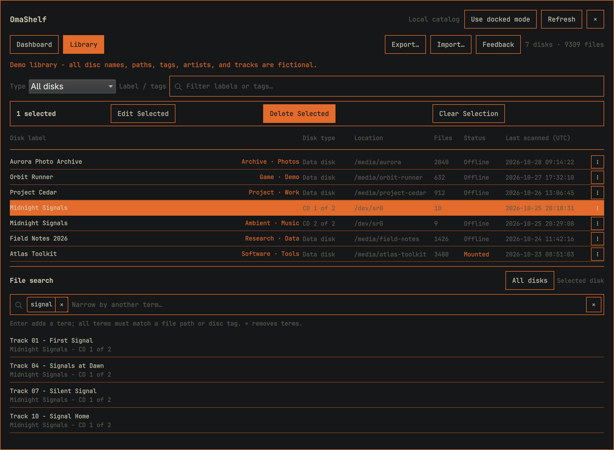

# OmaShelf

**A local media catalog for the Omarchy bar.** Index data discs and mounted
folders, identify audio CDs, and find files without reinserting the original
media.



*Preview of the actual plugin UI using entirely fictional disc names, paths,
tags, artists, and tracks. No personal catalog data is included.*

| | |
| --- | --- |
| Plugin ID | `kel.omashelf` |
| Version | `0.1.0` |
| Author | Kelly |
| License | [MIT](LICENSE) |
| Suggested marketplace category | Productivity |
| Suggested marketplace tags | `bar`, `media`, `quickshell` |

## Features

- **Offline library:** recursively catalog file names and sizes from mounted
  data CDs, DVDs, USB drives, other supported volumes, or a chosen folder.
- **Audio CDs:** catalog track listings and explicitly look up titles,
  artists, cover art, and **CD X of Y** numbering through MusicBrainz and
  Cover Art Archive.
- **Compact table:** single-line rows without thumbnails show labels, tags,
  type, catalog location, file count, availability, and last scan time in UTC.
- **Term filters:** filter labels/tags or file paths/tags using removable
  chips. Terms are case-insensitive and all entered terms must match.
- **Editing and tagging:** change labels, artists, catalog locations, audio
  CD numbering, and tags. Manual edits survive rescanning and identification.
- **Bulk operations:** edit selected fields, add/remove/replace tags, or
  remove multiple entries from the catalog.
- **Portable backups:** export or import the entire library as JSON or XML,
  including tags, saved edits, indexed paths, and embedded artwork.
- **Two launch modes:** use the docked bar panel or open a standalone app
  window. The interface follows the current Omarchy theme.
- **Feedback:** open prefilled GitHub feature-request and bug-report forms
  from the plugin.

OmaShelf is a catalog, not a disc ripper, burner, or media player.

## Requirements

Use an up-to-date **Omarchy Quattro** installation with its Quickshell-based
shell and Qt Quick Controls/Dialogs.

| Dependency | Used for |
| --- | --- |
| Python 3 | Backend; SQLite, JSON, XML, and HTTP support use only the standard library |
| `findmnt` from `util-linux` | Discovering mounted data volumes |
| `cdparanoia` | Optional: detecting audio CDs and reading their track layout |
| Internet access | Optional: audio-CD identification, artwork, and GitHub feedback |

Python and `util-linux` are normally present on Omarchy. To add audio-CD
support:

```sh
omarchy pkg add cdparanoia
```

No pip packages, account, API key, or privileged media scanning is required.
The current interface is in English.

## Install

Review the source before enabling any community plugin: Omarchy plugins run
as unsandboxed code in your desktop session.

```sh
omarchy plugin add https://github.com/kelmankenberg/OmaShelf.git --enable
```

Follow the placement prompt, then click the disc icon in the bar. If installed
without enabling it:

```sh
omarchy plugin enable kel.omashelf
```

OmaShelf defaults to the right-hand bar section. You can move it with:

```sh
omarchy bar move kel.omashelf --section right
```

If a previous locally built copy already occupies the same plugin ID, export
your library first, remove that plugin through Omarchy, and install the
repository version. Do not overwrite or delete your catalog to reinstall.

## Use

### Catalog media

In **Dashboard**, scan a listed mounted volume or choose **Scan a folder**.
Mount data media first; OmaShelf does not mount, eject, format, or modify it.
Scans save names and sizes, not file contents.

For an inserted audio CD, choose **Identify & add**. Identification is an
explicit online action; if lookup fails, the track list is still retained
locally. **Identify again** retries the lookup and can add missing disc
numbering. Numbering and metadata depend on the matching MusicBrainz release.

### Browse, select, and filter

In **Library**, click a row to select only that disc and browse its files.
**Ctrl-click** adds or removes individual discs; **Shift-click** selects an
inclusive range in the currently filtered list. **Ctrl-Shift-click** adds a
range to the selection. **Clear Selection** clears the file scope as well.

Type into a filter to search immediately. Press Enter to add a persistent
term chip, use a chip's **×** to remove it, or use the field's **×** to clear
all terms. Backspace in an empty input removes the last term. Tags can be
combined with label or filename terms, such as `Game` and `manual`.

### Edit and remove entries

Use a row's **⋮ > Edit** menu for individual changes. Use **Edit Selected**
for bulk changes: unchecked metadata fields remain unchanged, and tags can
be kept, added, removed, or replaced. Replacing with an empty tag list clears
tags. CD numbering is available for audio-only selections.

Catalog locations are descriptive metadata: editing one does not move files
or change the physical scan source. Delete actions remove catalog entries
and their indexes only, never the source media. Bulk edits are atomic.

### Back up and restore

**Export…** opens a save dialog so you can choose the folder, filename, and
JSON or XML format. JSON backups default to
`OmaShelf_backup_<YYYY-MM-DD_HH-mm-ss>.json`, using the current local time.

**Import…** validates an OmaShelf export and previews disc/file counts and
matching entries before any library changes:

- **Merge / keep existing:** add new disc IDs and leave matching entries alone.
- **Merge / replace matching:** replace matching entries, files, tags, and saved
  edits while preserving other discs.
- **Replace entire library:** remove current catalog entries and restore the
  imported library.

Overwriting requires explicit confirmation. Importing never scans or changes
source media, and does not change launch mode or application settings.
Library files are limited to 256 MB, 10,000 discs, and 1,000,000 indexed files,
with at most 200,000 files per disc.

Choose **Open as app** for the standalone window, or **Use docked mode** to
switch back. The selected launch mode is remembered.

## Data and privacy

By default, OmaShelf stores its SQLite catalog, scan status, launch preference,
and downloaded artwork under:

```text
~/.local/share/omashelf/
```

It honors `XDG_DATA_HOME`. For development, `OMASHELF_DATA_DIR` overrides the
entire storage directory; the shell and backend must see the same setting.

Cataloging and searching are local. Only explicit audio identification contacts
MusicBrainz with a disc ID and retrieves available artwork from Cover Art
Archive, which may redirect image downloads to its hosting service. Original
media files and your library are not uploaded.

Exports contain local paths, labels, tags, and metadata. Review them before
sharing. **Feedback** opens a browser form for you to review and submit;
no catalog, diagnostics, or attachments are sent automatically.

## Update and remove

For a Git-managed installation:

```sh
omarchy plugin update kel.omashelf
```

To disable the widget or remove the plugin:

```sh
omarchy plugin disable kel.omashelf
omarchy plugin remove kel.omashelf
```

The default catalog directory is separate from the plugin and remains on disk.
Keep an export before updating or reinstalling. If a QML change has not appeared
after an update, run `omarchy restart shell`.

## Feedback and development

Use **Feedback > Request a feature / Report a bug**, or
[open a GitHub issue](https://github.com/kelmankenberg/OmaShelf/issues/new).
Include the Omarchy/plugin versions and reproduction steps; inspect screenshots
and logs for private data first.

The repository root is the installable plugin. `BarWidget.qml` is the bar
entry point, `Panel.qml` manages state and backend commands, `CatalogView.qml`
provides the UI, `Selection.js` handles selection, and `bin/omashelf.py` is the
Python backend.

From a checkout, validate the manifest and run the isolated backend tests:

```sh
omarchy plugin validate .
PYTHONDONTWRITEBYTECODE=1 PYTHONWARNINGS=ignore::ResourceWarning \
  python3 -m unittest discover -s tests -v
```

Run the modifier-selection tests with Qt 6:

```sh
QT_QPA_PLATFORM=offscreen QT_QUICK_BACKEND=software \
  /usr/lib/qt6/bin/qmltestrunner -input tests/tst_selection.qml
```

Tests use temporary catalogs and do not edit the installed library.

## Marketplace submission

The repository includes a root manifest, installation/removal instructions,
dependency information, MIT license, and `preview.png` for
[Omarchy Plugins](https://plugins.omarchy.org/publish.html).
Suggested listing metadata appears above. Marketplace publication requires a
separate submission and maintainer approval; a listing is not a security audit.

## License and credits

OmaShelf is available under the [MIT license](LICENSE). MusicBrainz and
Cover Art Archive are independent services with their own data and artwork
licenses; the code license does not relicense their content.
